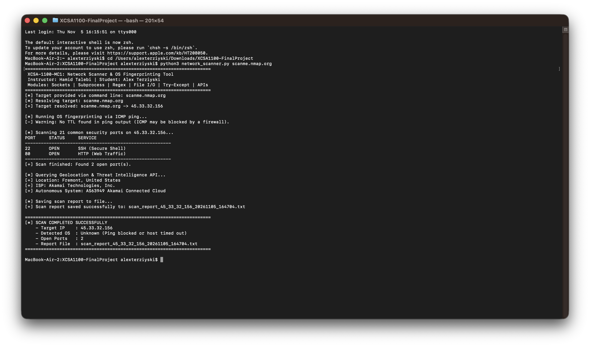

# XCSA-1100-MC1: Automated Network Reconnaissance & OS Fingerprinter

> **Course**: XCSA-1100-MC1 - Network Programming for Security Analysts  
> **Instructor**: Hamid Talebi  
> **Date**: November 5th, 2026
> **Author**: Alex Terziyski (alexterziyski@gmail.com)  
> **Core Topics**: Python Fundamentals | Socket Programming | Subprocess Management | Regular Expressions | File Operations | Try-Except Handling | REST API Integration  

[](https://www.python.org/)
[](LICENSE)
[](https://csrc.nist.gov/)
[](#course-modules-and-curriculum-alignment)


**Course**: XCSA-1100-MC1 - Network Programming for Security Analysts  
**Instructor**: Hamid Talebi  
**Author**: Alex Terziyski  
**Language**: Python 3 (Standard Library Only)  

---

## 1. Project Overview and Purpose

In security assessments and penetration testing, reconnaissance is the crucial initial phase. Before an analyst or administrator can evaluate security posture or harden infrastructure, they must determine:
1. Whether a target host is active and responsive on the network.
2. What operating system family is powering the host.
3. Which standard network services and TCP ports are open and exposed to potential threats.
4. What autonomous system, internet service provider, and geographical location host the system.

network_scanner.py is an automated, command-line reconnaissance tool engineered specifically for network security analysts. It consolidates host resolution, passive operating system fingerprinting, TCP port scanning, public threat intelligence enrichment, and audit report generation into a single execution flow.

A core engineering requirement of this project is that it runs entirely on Python's built-in standard library (socket, subprocess, re, urllib.request, json, datetime, and platform). It requires no third-party package installations (pip install is not required) and does not rely on external binary frameworks such as Nmap or Scapy.

---

## 2. How the Program Works

The script executes five distinct operational stages:

### Stage 1: Input Sanitization and Hostname Resolution
The user can supply an IP address, domain name, or fully qualified domain name (FQDN) either as a command-line argument or interactively at runtime. The input is sanitized to strip protocol prefixes (http://, https://) and trailing path segments. The script then invokes socket.gethostbyname() to resolve the hostname to an IPv4 address.

### Stage 2: Passive OS Fingerprinting via ICMP TTL Heuristics
Rather than sending noisy, complex OS detection probes, the tool utilizes ICMP Time-to-Live (TTL) inspection:
1. The script spawns a single ICMP Echo Request (ping) process via subprocess.run(). It dynamically adapts flags based on the host platform (-c 1 -W 2000 on macOS Darwin, -c 1 -W 2 on Linux, and -n 1 -w 2000 on Windows).
2. The stdout text from ping is captured and parsed with a regular expression (re.search(r'(?i)ttl[=\s](\d+)', output)) to extract the integer TTL field returned in the ICMP Echo Reply.
3. Major operating system kernels initialize their IP packet headers with distinct baseline TTL defaults:
   - Linux / Unix / macOS / Android: Default baseline TTL of 64
   - Microsoft Windows: Default baseline TTL of 128
   - Cisco IOS / Network Appliances: Default baseline TTL of 255
4. Because each intermediate router decrements the TTL by 1 as the packet hops across the network, the tool determines the closest baseline, computes the estimated router hops (Hops = Baseline TTL - Arriving TTL), and identifies the operating system family.

### Stage 3: TCP Port Scanning
The script iterates across a dictionary of 21 common network service ports (such as SSH on port 22, DNS on port 53, HTTP on port 80, HTTPS on port 443, SMB on port 445, MySQL on port 3306, and RDP on port 3389). For each port, it instantiates an AF_INET stream socket (socket.SOCK_STREAM) with a non-blocking timeout of 1.0 second and initiates a 3-way TCP handshake using socket.connect_ex((ip, port)). An integer return code of 0 denotes an open, accepting port.

### Stage 4: Geolocation and Threat Intelligence Enrichment
For public IP addresses, the script queries the ip-api.com REST endpoint using urllib.request.urlopen() and parses the returned JSON payload with json.loads(). It extracts the target's physical country, city, ISP name, and Autonomous System Number (ASN). If the address falls within an RFC 1918 private intranet range (10.0.0.0/8, 172.16.0.0/12, 192.168.0.0/16) or loopback (127.0.0.1), external API calls are skipped to avoid unnecessary traffic.

### Stage 5: Timestamped File Audit Logging
Using Python's context manager (with open(filename, "w", encoding="utf-8")), the script writes a structured text report named scan_report_<IP>_<timestamp>.txt to disk. This ensures all collected indicators are preserved for compliance and incident response records.

---

## 3. Verified Test Execution Results

The script was tested against scanme.nmap.org (an authorized testing host provided by the Nmap Project) on macOS. Below is the terminal output captured during testing:



### Summary of Captured Results:
- Target Resolved: scanme.nmap.org -> 45.33.32.156
- ICMP Echo Reply TTL: 54
- Baseline TTL: 64 (Estimated 10 router hops)
- Detected Operating System: Linux / Unix / macOS / Android
- Discovered Open Ports: Port 22 (SSH) and Port 80 (HTTP)
- Geographic Location: Fremont, California, United States
- Hosting Provider / ASN: AS63949 Akamai Connected Cloud
- Report Generated: scan_report_45_33_32_156_20261105_165747.txt

---

## 4. Technical Caveats and Operational Limitations

While effective for standard reconnaissance, security analysts should be aware of several technical caveats inherent to network programming:

1. Firewall and ICMP Filtering:
   Many modern enterprise firewalls and cloud security groups block incoming ICMP Echo Requests (ping). If the target drops ICMP packets, the script will report that the host did not respond to ping, preventing TTL-based OS fingerprinting even if TCP ports on the machine remain open.

2. Network Address Translation (NAT) and Proxies:
   When packets pass through certain stateful proxies, load balancers, or packet-scrubbing services (e.g., Cloudflare reverse proxies), the TTL field in the packet may be rewritten by the proxy rather than reflecting the origin server's operating system.

3. Full TCP Connect Scanning vs. Stealth (SYN) Scanning:
   socket.connect_ex() completes a full 3-way TCP handshake (SYN, SYN-ACK, ACK) and immediately closes the connection. While this allows the script to run with standard unprivileged user permissions across any operating system without requiring root or administrator privileges, full-connect scans are logged by host intrusion detection systems (IDS) and application servers.

4. Private and Non-Routable IP Addresses:
   IP geolocation services only index public internet addresses. Running the tool against 127.0.0.1 (localhost) or local subnets (192.168.x.x) will correctly identify open local ports and ping replies, but external geographic lookup will be marked as a local or private address.

5. Rate Limiting:
   Public geolocation APIs enforce rate limits (typically 45 requests per minute for non-commercial endpoints). Batch scanning large subnets in rapid succession would require commercial API keys or local MaxMind GeoLite databases.

---

## 5. Usage Instructions

### Prerequisites
- Python 3.8 or later installed.
- No external packages required (pip install is not needed).

### Running a Scan via Command Line
```bash
# Scan a remote authorized host:
python3 network_scanner.py scanme.nmap.org

# Scan a public DNS resolver:
python3 network_scanner.py 1.1.1.1

# Scan your local machine loopback:
python3 network_scanner.py 127.0.0.1